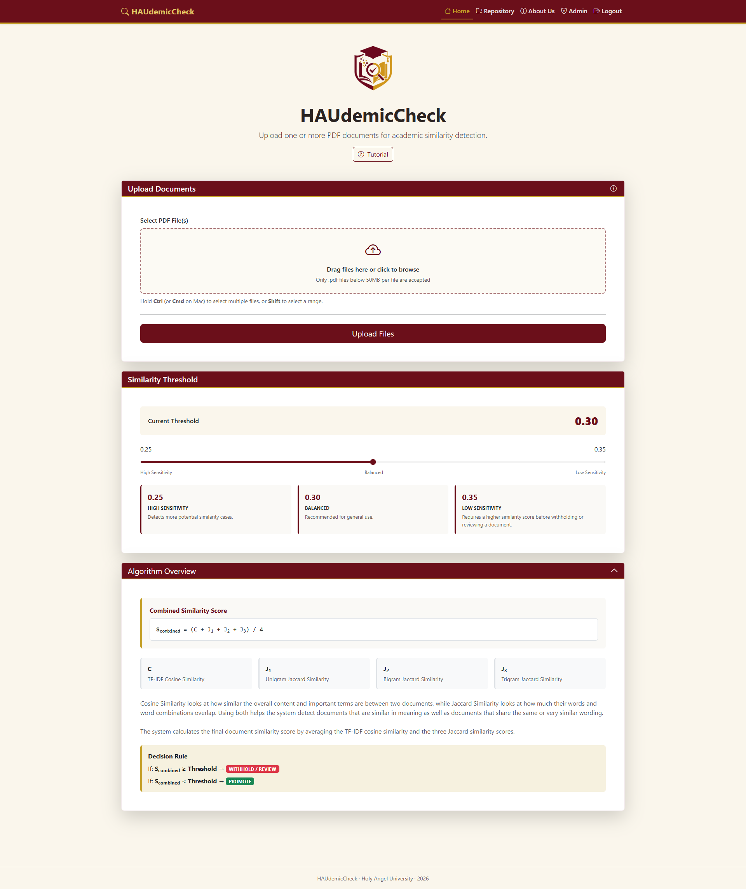
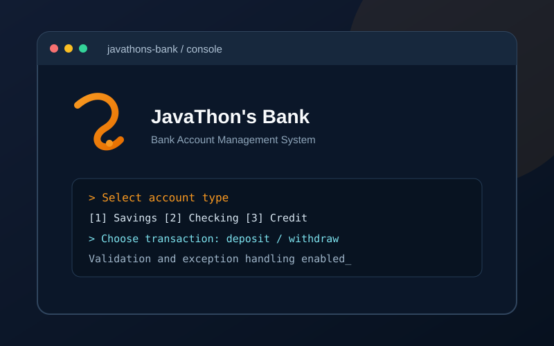

# Redenelle Maurice Manangu

## Computer Science Student | UI/UX Design | QA Testing | Software Development

[](#portfolio-website)
[](https://github.com/rdmanangu)
[](https://linkedin.com/in/redenelle-manangu-6b98a7317)

> Building practical digital solutions with thoughtful interfaces, reliable software, and a quality-focused mindset.

I am a Bachelor of Science in Computer Science student at **Holy Angel University** in Pampanga, Philippines. I am seeking **OJT and internship opportunities** in UI/UX design, quality assurance, software testing, software development, frontend development, web development, and related IT roles.

## About Me

I enjoy developing web applications, improving user experiences, and evaluating software functionality and usability. My interests span the product lifecycle—from wireframing and responsive interfaces to backend integration, database management, testing, documentation, and bug identification.

I am eager to learn from experienced teams, collaborate on meaningful projects, and gain professional industry experience through an OJT or internship placement.

## Portfolio Website

**Live website:** Add the deployed portfolio URL here

This repository contains my responsive personal portfolio website. It presents my academic projects, technical skills, education, certifications, achievements, and contact information in a dark navy and cyan developer-focused interface.

### Website Features

- Responsive layout for mobile, tablet, and desktop screens
- Project showcase with screenshots, descriptions, technology badges, and available live demos
- Filterable technical skills section
- Education, certifications, training, and academic achievements timeline
- Accessible keyboard navigation and visible focus states
- Reduced-motion support
- Contact form validation with email-draft support
- Direct email, GitHub, LinkedIn, and resume links

## Tech Stack

### Programming Languages


### Frontend


### Backend and Data


### Tools


### Data Science and Machine Learning


## Featured Projects

### HAUdemicCheck

**Web-Based Plagiarism Detection System**

A web-based document similarity detection system designed to assist instructors in evaluating academic submissions. It uses a hybrid similarity approach combining TF-IDF, cosine similarity, and Jaccard similarity.

**Technologies:** Python, Flask, scikit-learn, NLTK, Supabase, Docker  
**Live demo:** [Open HAUdemicCheck](https://haudemiccheck.com/login)  
**Repository:** Not currently available



### DentiPrice

**Dental Pricing and Appointment Inquiry Web App**

A full-stack web application that helps patients estimate dental treatment costs and submit appointment inquiries. It includes a price estimator, inquiry form, and administrative modules.

**Technologies:** React, TypeScript, Vite, Tailwind CSS, Supabase, PostgreSQL  
**Live demo:** [Open DentiPrice](https://dentiprice.onrender.com)  
**Repository:** Not currently available


### JavaThon's Bank

**Bank Account Management System**

A console-based Java application for managing savings, checking, and credit accounts. The project demonstrates inheritance, encapsulation, polymorphism, deposits, withdrawals, credit borrowing and repayments, interest calculations, fees, validation, and exception handling.

**Technologies:** Java, Object-Oriented Programming (OOP)  
**Live demo:** Not available  
**Repository:** Not currently available



## Skills and Interests

- UI/UX design, wireframing, and prototyping
- Responsive web design and frontend development
- Usability testing and software testing
- Bug identification and quality assurance
- Software documentation
- Backend development and database management
- Authentication and row-level security
- Data visualization

## Certifications and Achievements

### Certifications and Training

- Relational Database Developer — freeCodeCamp
- Responsive Web Design Developer — freeCodeCamp
- Endpoint Security — Cisco Networking Academy
- Introduction to Networks — Cisco Networking Academy
- JavaScript Essentials — Cisco Networking Academy
- AI Fundamentals with IBM SkillsBuild — Cisco Networking Academy
- Cloud Foundations — AWS Academy Graduate
- Frontend Design with Cloud
- Full Stack Web Development
- Builds Full-Stack JavaScript and AI

### Academic Achievements

- Dean's Lister — 6 semesters
- President's Lister — 1 semester

## Education

**Bachelor of Science in Computer Science**  
Holy Angel University · 2023–2027

**Senior High School — STEM**  
Montessori De Sagrada Familia, Inc. · 2021–2023  
With Highest Honors

## Run Locally

```bash
cd Manangu-porfolio
npm install
npm run dev
```

Open the local URL printed by Vite.

### Build and Test

```bash
npm run build
npm test
```

The browser test suite checks responsive layouts at 320px, 375px, 390px, 430px, 768px, 1024px, 1280px, 1440px, and 1920px. It also checks keyboard interactions, reduced-motion behavior, and accessibility with axe.

## Contact

I am open to OJT and internship opportunities in Pampanga, nearby areas, and remote teams.

- **Email:** [manangurednelle@gmail.com](mailto:manangurednelle@gmail.com)
- **GitHub:** [github.com/rdmanangu](https://github.com/rdmanangu)
- **LinkedIn:** [linkedin.com/in/redenelle-manangu-6b98a7317](https://linkedin.com/in/redenelle-manangu-6b98a7317)
- **Resume:** [View resume](https://drive.google.com/file/d/1DEjlITljuFDUSuAsASlUE5MkvwN3rBXC/view?usp=sharing)

---

Thank you for visiting my portfolio. I welcome opportunities to learn, contribute, and grow with a supportive technology team.
